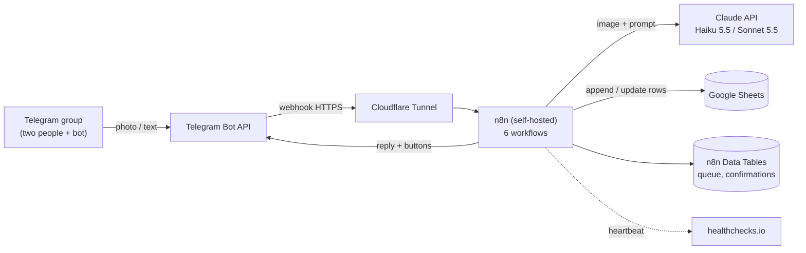

# n8n Telegram Finance Bot

A household expense tracker that runs on a **self-hosted n8n** instance. Send a bank-transfer or QRIS
screenshot (or a short text like `kopi 25rb`) to a Telegram group. Claude reads the amount, date, merchant
and category, the row lands in **Google Sheets**, and the bot answers with what it recorded plus **Undo** and
**Change category** buttons. A cycle report is posted automatically on the 26th of every month.

It was built for a home server behind **CGNAT**, so it is designed to survive outages: every message is saved
to a local queue *before* any API call, failed work is retried automatically, and you get alerts when something
stays broken.

<!-- EDIT: add a one-line status, e.g. "Running daily on my homelab since <month year>." -->

## Features

- Telegram **group** support (two people share one bot); sender is recorded per transaction
- Reads payment **screenshots** (vision) and **plain text** (`kemarin bensin 50rb`, `gaji 5jt`)
- Claude **Haiku 5.5** by default, automatic retry with **Sonnet 5.5** when the result is uncertain
- Low-confidence results ask for a **Yes / No** confirmation instead of guessing
- **Undo** and **edit** (`/undo`, `/edit`, inline buttons); rows are voided, never deleted
- **Duplicate protection** (Telegram update ID and bank reference number)
- **Write-ahead queue** with retries every 15 minutes, permanent-failure alert after 5 attempts
- **Error workflow** (Telegram DM with node name and execution link) and an external **heartbeat**
- Cycle report (26th to 25th) on the 26th, plus `/summary` on demand; all arithmetic is done in code, never by the LLM
- Cost: a few cents per month at about 150 transactions (see [docs/cost.md](docs/cost.md))

## Architecture



More diagrams and the design decisions are in [docs/architecture.md](docs/architecture.md).

## Workflows

| Workflow | Trigger | Purpose |
|---|---|---|
| FIN-01 Ingest | Telegram Trigger | Whitelist, route, write-ahead queue, commands, button callbacks |
| FIN-02 Process Txn | Execute Workflow | Claude extraction, validation, Sheet append, reply, queue bookkeeping |
| FIN-03 Retry Queue | Schedule, 15 min | Re-run pending queue rows, alert on permanent failures |
| FIN-04 Report | Schedule daily + Execute Workflow | Cycle report on the 26th, `/summary` on demand |
| FIN-98 Heartbeat | Schedule, 5 min | Ping healthchecks.io so downtime is noticed externally |
| FIN-99 Error Handler | Error Trigger | Telegram alert to the admin, rate-limited |

Node-by-node notes: [docs/workflows.md](docs/workflows.md).

## Screenshots

<!-- Add your own images to docs/screenshots (see docs/screenshots/README.md for the file names).
     Blur names, amounts, chat IDs and any n8n panel that shows IDs before committing. -->

| Chat demo | Google Sheet | Monthly report |
|---|---|---|
|  |  |  |

| FIN-01 Ingest | FIN-02 Process | FIN-03 Retry | FIN-04 Report |
|---|---|---|---|
|  |  |  |  |

## Quick start

1. [Telegram bot and group](docs/setup-telegram.md)
2. [Claude API key](docs/setup-claude-api.md)
3. [Google Sheets with a service account](docs/setup-google-sheets.md)
4. [n8n, tunnel, credentials, data tables](docs/setup-n8n.md)
5. Import the workflows from [workflows/](workflows/README.md) and re-select the credentials
6. Run the [tests and failure drills](docs/testing.md)

Smoke-test your keys before you build anything: copy `.env.example` to `.env`, fill it in, run `scripts/smoke-test.sh`.

## Repository layout

```
.
├── README.md
├── SECURITY.md              what must never be committed + publishing checklist
├── .env.example             documents the values you need (real values stay in .env, git-ignored)
├── config/config.example.json   the Config node JSON with placeholders
├── templates/               Google Sheet header rows (CSV)
├── prompts/                 the Claude extraction prompt
├── workflows/               sanitized n8n exports (see workflows/README.md)
├── scripts/                 sanitize_workflow.py, check_secrets.py, smoke-test.sh, pre-commit
├── docs/                    architecture, setup guides, workflow notes, testing, troubleshooting
└── .github/workflows/       secret scan + JSON validation on every push
```

## Security

No credentials live in this repository. API keys and tokens are stored in **n8n credentials**; IDs are
replaced by placeholders by `scripts/sanitize_workflow.py`; `scripts/check_secrets.py` and a GitHub Action
scan every push. Read [SECURITY.md](SECURITY.md) before you publish your own copy.

## Limitations and roadmap

- Single currency (IDR), two-person household, categories are a fixed list
- Merchant memory (same shop = same category), budget alerts at 80%, and a free-text `/ask` over the data are planned
- Models and prices change; check the official pricing pages before relying on the cost estimate

## License

MIT, see [LICENSE](LICENSE).
