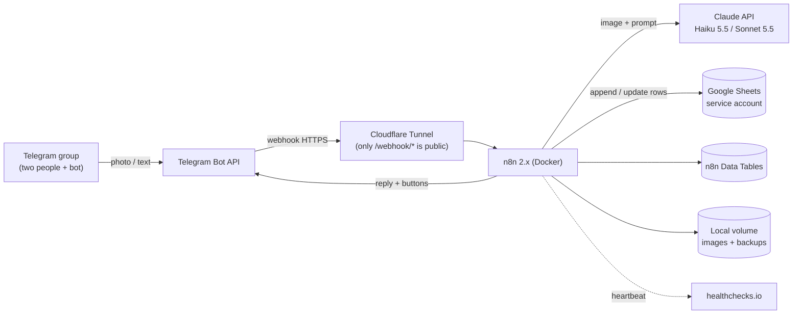
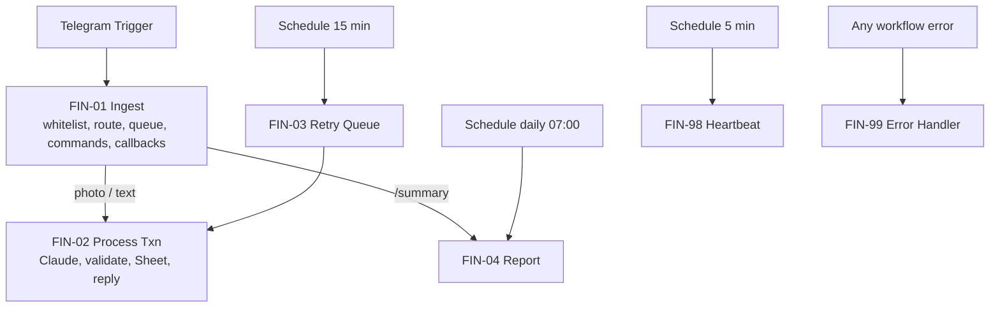
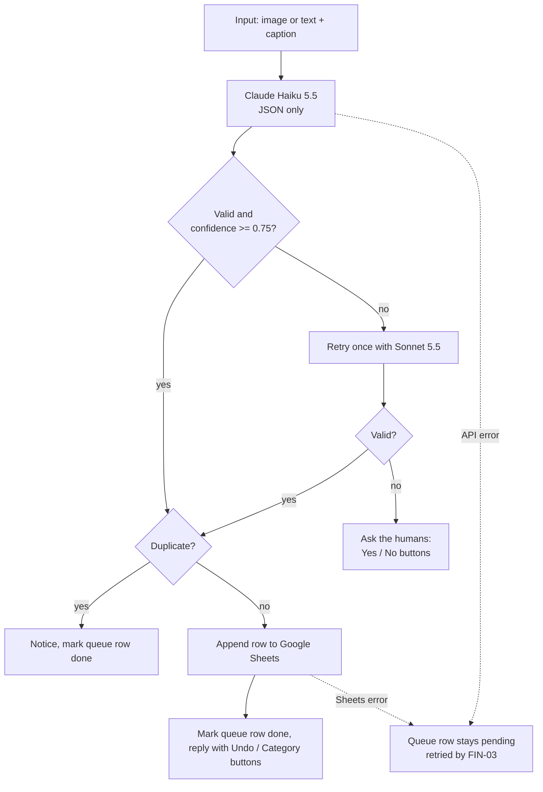

# Architecture

## System context

The home server is behind CGNAT and accepts **no inbound connections**: the Cloudflare tunnel is an outbound
connection, and Telegram delivers updates to a public hostname that the tunnel forwards to n8n.

## Workflow map

## Processing a transaction (FIN-02)

## Design decisions

| Decision | Reason |
|---|---|
| **Write-ahead queue** (Data Table) before any API call | A crash or outage cannot lose a message; FIN-03 re-runs pending rows |
| **Idempotency key** (`src_id` = Telegram update ID) checked before every append | Retries and Telegram redeliveries never create duplicate rows |
| **Soft delete** (`status = void`) | Audit trail; reports ignore void rows |
| **LLM never does arithmetic** | All sums and comparisons are done in Code nodes; the model only writes optional commentary |
| **Fixed category list + validation in code** | Consistent data even when the model improvises |
| **Haiku first, Sonnet on low confidence** | Cheapest model that is accurate enough, with a safety net |
| **Service account for Google** | No OAuth token that expires after 7 days |
| **Plain-text date and reference columns** | Google Sheets would otherwise convert them and break filters |
| **Only `/webhook/*` exposed** | The n8n editor stays private |
| **Whitelist by Telegram user ID** | Strangers who add the bot to a group are ignored |
| **Heartbeat to an external service** | An Error Trigger cannot fire when n8n itself is down |
| **Cycle report, not calendar month** | Matches the household's salary cycle (26th to 25th); a daily check catches a missed day |

## Failure behaviour

| What fails | What happens | How you find out | Recovery |
|---|---|---|---|
| Home internet / tunnel / VM / n8n down | Telegram holds updates and redelivers later | healthchecks.io alert | Automatic; dedupe prevents doubles |
| n8n crashes mid-processing | Queue row was written first, so it is still `pending` | No reply to that message | FIN-03 within 15 min |
| Claude API error / 429 / overload | HTTP node retries, then error output | Bot says "saved to queue" + admin alert | FIN-03 retries; after 5 attempts a permanent-failure alert |
| Model returns bad JSON or low confidence | Retry with Sonnet, then ask for confirmation | Yes/No buttons | Tap Yes or type the entry |
| Google Sheets or credential problem | Append fails, row stays `pending` | Queue notice + admin alert | Fix credential; FIN-03 re-runs |
| Same screenshot sent twice | Blocked by `src_id` and `ref_no` | "Already recorded" notice | Undo if it was not a duplicate |
| Wrong amount or category | Row exists | You notice in the reply | `/undo`, `/edit`, or buttons |
